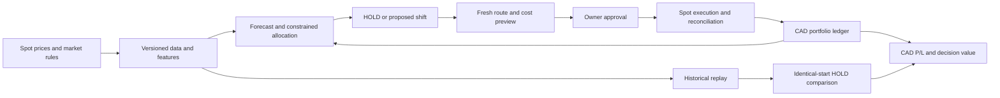

# CAD/BTC/ETH/LINK rotation: reviewable design

2026-10-12 Eastern. Status: investigation and proposed design; no application implementation, model fitting or performance result.

This exists so that "I'm looking to trade crypto; i just want to know when to shift positions between CAD/BTC/ETH/LINK any pairing in/out looking to only make weekly or monthly trades".

## Proposed product

One portfolio with four actual balances. At the owner's weekly or monthly review, show **HOLD** or an exact proposed change in balances. A recommendation is a proposal; only the owner's approval can authorize execution. Holding does not rebalance weights back to a target: units stay unchanged while market weights drift.

Recommend starting with an exchange-held account and an isolated spot service. Ndax is the first candidate for direct CAD markets; Kraken offers useful crypto cross markets. Final provider selection needs account-specific fees and fresh quotes at the owner's size. Self-custody remains an alternative with separate CAD rails, native-BTC integration and cross-chain settlement. See [provider evidence](PROVIDER-EVIDENCE.md).

Weekly/monthly refers to decision opportunities, not an obligation to trade. No futures, borrowing, leveraged positions, staking or LP allocation is part of this design. Do not substitute a stablecoin for CAD or wrapped BTC for BTC.

## Owner decisions still open

1. Exchange custody, self-custody plus fiat account, or both kept open; provider selection.
2. Starting CAD amount, opening holdings and their acquisition history if crypto is deposited, expected deposits/withdrawals.
3. Tolerable loss/drawdown, minimum CAD reserve, maximum per-asset exposure, whether an allocation can be entirely one asset. A stated tolerance is a planning constraint, not a guaranteed loss cap.
4. Weekly versus monthly review; preferred day/time in America/Toronto; whether emergency risk alerts may prompt an extra review. Default authorization never expands to automatic emergency trades.
5. Whether “series of wallets” means four asset balances, separate funded strategies, or paper experiments alongside a funded portfolio. Proposed simplest option: one funded account, four balances, isolated paper comparisons.

Questions have been presented to the owner. Unknown preferences stay explicit parameters; no invented risk profile, capital amount or allocation becomes a product default. Design and data investigation can proceed while they remain open. Numerical pass thresholds must be agreed and preregistered before viewing strategy results.

## Reuse and isolation

Source inspection covered WolfPack HEAD `60cccd7` and WolfHunt HEAD `f1f381e`. [Reuse evidence](REUSE-EVIDENCE.md) contains file/line provenance and wallet-query attempts.

| Existing piece | Adaptation boundary |
|---|---|
| WolfPack candle/order-book adapters and gap cache | Reuse shapes and caching concepts with explicit spot venue, base/quote, timestamps and completeness. Partial fetches cannot silently become a successful research dataset. |
| WolfPack Kraken connector | Contains USD candles, futures market discovery and frontend paper orders. Build/adapt a separately scoped spot interface; never treat this as ready CAD execution. |
| WolfHunt multiasset replay and Decimal wallet | Reuse chronology, cash/inventory accounting ideas; correct immediate signal-price fills, wall-clock position timestamps and fee semantics. |
| Existing backtest reports and walk-forward research | Reuse reporting patterns and chronological evaluation concepts; replace single-symbol/perp assumptions, scalar benchmarks and fixed hourly annualization. |
| Existing wagmi / wallet selector | Connection UI and experiment selection are distinct. Reuse relevant patterns after custody selection; native BTC and CAD require separate capabilities. |
| Existing manual approval UI | Reuse interaction pattern. Old API marks approval before some gates and executes through a paper-perp engine; it is not the execution endpoint for this project. |

WolfHunt's history loader falls back to synthetic data after fetch failure and constructs highs/lows from closes. These paths must never supply investment backtests. WolfPack's replay passes full history plus an index into strategies: isolate feature input to available history instead of trusting every model to ignore future rows.

Proposed implementation location: a separate spot-rotation domain in this monorepo, with a separate process entry point, dedicated configuration and dedicated data namespace. Do not import/start the old FastAPI application as a library: startup behavior includes old trading/intelligence machinery. Share pure extracted types/helpers only after impact review. Existing `paper_perp*`, `prod_perp`, LP settings and `performance_tracker.py` policies remain outside the change scope.

Current live wallets/configs could not be established: repo Supabase hostname failed DNS; other configured projects returned table-query errors/zero matching catalog rows; local wallet API timed out. This is an unresolved system-of-record mapping, not evidence that wallets disappeared. It does not prevent a separate design. Any reuse of existing storage must first resolve that mapping and verify access controls. Historical INBOX security claims are investigation leads, not current security findings.

## Architecture and contracts

Proposed interfaces, before implementation:

- **Market snapshot:** venue/instrument, canonical base and quote, chain identity when relevant, trade availability, bid/ask depth, event time, retrieval time, minimum quantity/notional, increments, applicable fees, freshness and provenance. Use decimal quantities; BTC/XBT is an explicit alias.
- **Account snapshot:** portfolio ID, actual/available/reserved units, open orders, external-flow cursor, exchange history cursor and reconciliation time. Never substitute cached paper balances when live reads fail.
- **Forecast:** data/model/trial versions, decision time, explicit horizon/end time, joint CAD-return scenarios for all four assets and calibration record. CAD's nominal price is one; assume no interest income unless a verified holding product is explicitly selected.
- **Recommendation:** starting holdings hash, HOLD or target amounts/weights, constraints and reasons, forecast for proposed action and untouched holdings on the same scenarios, net incremental distribution, quote/cost assumptions and expiry. Weights are nonnegative and sum to one after reserving costs; limits are owner-approved configuration.
- **Approval:** authenticated owner, exact recommendation/quote version, bounded sell amounts and buy spending, limit prices/minimum received, valid-until time, explicit route and aggregate cost limit. Revised terms require new approval.
- **Execution:** immutable parent intent and per-leg client IDs; planned, approved, submitted, partially filled, filled, canceled, rejected, expired and reconciliation-needed states. Record venue order/fill IDs and exact asset-denominated fees.
- **Accounting:** append-only fills, funding, withdrawals, transfers and corrections; derived balances/valuation/cost basis; opening holdings and baseline version; dedupe by venue event IDs. Separate strategy/model versions from real-money portfolio identity.

Potential tables are `rotation_portfolios`, `rotation_events`, `rotation_snapshots`, `rotation_recommendations`, `rotation_approvals`, `rotation_orders`, `rotation_trials` and `rotation_data_manifests`. These are proposed contracts, not authorized/applied migrations. Check existing storage patterns before creating physical tables; account secrets belong in a server secret store, not these rows or client bundles.

## Execution after an owner click

1. Generate recommendation from reconciled holdings and completed market data. Failure or stale data means “data unavailable” with execution disabled; distinguish this from a model's valid HOLD recommendation.
2. On review, fetch fresh books and rules, calculate one or more permitted routes within CAD/BTC/ETH/LINK, and show exact amounts, fees, expected units, limits and expiry. Do not hide an intermediate currency or mix venues without approval.
3. Accept approval only for that version and current account snapshot. One active rebalance per portfolio; database uniqueness and a per-portfolio lock prevent overlapping approvals.
4. Use protected orders with explicit limits. A two-leg conversion is not atomic. Submit the second leg only against proceeds actually filled on the first, within the approved envelope. Reprice beyond the envelope or expired approval returns to owner review.
5. On timeout, look up the client/order ID and reconcile before retrying. A client-supplied ID alone does not prove the venue enforces idempotency. Partial fills, canceled remainders and remaining CAD/crypto are shown as actual balances; never assume a complete rebalance.
6. Ingest fees and fills, reconcile exchange inventory, then finalize performance. A mismatch prevents further orders until resolved. Any resumption can continue only an unexpired, bounded approval.

Trade-only credentials reduce transfer capability but still require server-side authentication, ownership checks, secret protection, audit history and request forgery protection. A model or UI cannot expand the allowed asset set, account, quantities or permissions. Key creation/import, live connectivity and trading require later explicit authorization.

## Accounting and no-action comparisons

Primary valuation is CAD: `V(t) = CAD units + Σ(crypto units × synchronized CAD mark)`. Show valuation freshness. Maintain both mark-to-market value and, when useful, estimated liquidation value net exit costs; compare like with like.

Portfolio profit in CAD is `V(end) − V(start) − deposits + withdrawals`, with flows valued at the event-time CAD mark and fees charged once. Transfers inside the measured portfolio are not external flows. Track fees in the asset actually charged; an asset fee changes inventory as well as CAD performance. Realized and unrealized P/L use an explicit, consistent cost-basis method, provisionally weighted average for performance reporting. Unknown acquisition history is marked unknown instead of invented. Display “before tax”; performance accounting is not a completed tax calculation.

**Lifetime no-action baseline:** clone exact initial units, start timestamp and valuation policy. Never reset it after an unfavorable trade. Keep initial units unchanged except mandated identical external-flow treatment. Proposed flow rule to confirm: CAD contributions enter both accounts as CAD; in-kind contributions enter both as identical units; withdrawals remove the same CAD amount at the same time, using CAD first and proportional liquidation when needed, charging each path its actual/modelled disposal costs. Apply one frozen rule to both paths. If one path cannot support a requested withdrawal, flag comparison insolvency instead of silently changing the flow or injecting money.

Use time-weighted returns by valuing just before each external flow and chaining subperiod returns; show money-weighted return only with enough valid cash-flow data. CAD incremental decision value is `V(actual) − V(baseline)` under matched flows. Show initial value, contributions, withdrawals, current value, realized/unrealized P/L, total costs and incremental gain/loss side by side. An all-CAD initial HOLD benchmark is correctly flat before external flows; also report diversified/static comparators so beating cash alone is not mistaken for predictive skill.

**Recommendation comparison:** at each decision, clone that same current inventory twice. One path carries out the approved shift with all costs and execution delay; the other holds. Value both at the stated horizon using the same prices and flow rule, with no later discretionary trades inside this isolated comparison. Separately report actual subsequent portfolio performance. If the owner declines or changes the proposal, preserve recommended, approved and executed actions separately. Overlapping decision comparisons are not additive and must not be summed into portfolio profit.

## Prediction and uncertainty

Research starts with simple baselines: unchanged holdings; static asset holdings; a disclosed fixed allocation; a slow momentum rule with CAD as an option; and a regularized return/rank model. Exact static weights are research controls, not owner allocations. Use a small preregistered set of lagged returns, realized volatility and relative BTC/ETH/LINK strength. Add more complex predictors only if they improve unseen, net-cost decisions over the simple alternatives.

Predict a joint distribution, not independent best-case returns for each asset. Compare candidate constrained allocations with unchanged holdings using the same scenarios. Deduct route-specific costs, penalize turnover and reject changes with insufficient expected advantage under a threshold selected only on training/validation data and approved before final testing. Allow partial shifts and HOLD; do not hardwire all-in rotation or choose a risk penalty for the owner.

Each review shows a fixed horizon (7 days or the explicitly dated next monthly review), expected CAD P/L for shift and hold, their incremental expected benefit after costs, central and downside outcome ranges, probability of underperforming hold, data freshness and historical calibration/sample count. A calendar month is not silently treated as 30 days; 30-day research labels must be labeled as such.

Calibrate on chronological out-of-sample residuals using dependence-aware blocks or another preregistered time-series calibration method; preserve cross-asset correlation. Measure interval coverage and calibration by horizon and regime. Prediction ranges describe observed/modelled uncertainty, not maximum possible loss; losses can exceed them. If samples or coverage are inadequate, show insufficient evidence and scenario ranges, not a calibrated probability claim. LLM explanations may summarize validated evidence; LLM confidence scores are not forecast probabilities.

## Backtest protocol

**Data gate.** Inventory real spot data before fixing dates. Require common BTC/ETH/LINK coverage, CAD marks, correct pair identity, raw-source hashes, listing dates, fees and publication/availability timestamps. Prefer execution-venue CAD history; independently sourced spot history may support signal research but must not masquerade as executable venue liquidity. Reconstruct cross prices only from synchronized observations and label derivation. Missing candles are not automatically zero returns; distinguish no trade from data outage, and enforce a stale-mark limit.

[Kraken documents full downloadable history through June 30, 2026](https://support.kraken.com/articles/360047124832-downloadable-historical-ohlcvt-open-high-low-close-volume-trades-data) and its [OHLC API](https://docs.kraken.com/api-reference/market-data/get-ohlc-data) returns only the most recent 720 entries including an unfinished last bar. Use archives plus verified incremental coverage, not a backwards-pagination assumption. Ndax documents public `GetTickerHistory`; coverage, pagination and actual timestamp behavior remain to be measured. No archive download or completeness claim was made here.

**Freeze research before scoring.** Register source hashes, universe, features, strategy families, all trial variants, costs, benchmark flow rules, folds and final holdout. Proposed protocol: reserve the most recent 12 complete months as an untouched final period; use preceding data for an initial 24-month training window and expanding chronological outer test folds of 3–6 months, with strictly earlier inner validation. These durations are design proposals subject to data coverage; freeze final dates and sample requirements before viewing results. Monthly strategies have few independent decisions; report that limitation explicitly.

**Prevent leakage.** No randomized time split. Fit transformations, hyperparameters, feature selection, allocation/risk tuning and interval calibration inside training/validation only. A training label must end before the first validation/test decision; purge overlaps by the full forecast horizon plus execution delay. At each decision expose only data actually available then. Delayed releases and revised data require point-in-time versions. A forecast based on a closing bar cannot receive that same closing price as its fill.

**Simulate the real decision path.** Evaluate weekly and monthly schedules without forcing trades. Include an explicit owner-response delay distribution/scenarios and expired/missed approvals. Buy at ask/sell at bid with size-dependent impact and all per-leg fees; account for minimums, rounding, insufficient balances, funding availability, LINK account limits, partial fills and stale-data refusal. Limit orders need an honest fill/queue rule; a candle touching a price does not guarantee a fill. Use current-account-cost scenarios for forward viability and historically documented costs when claiming historical executable performance; label the difference. Stress costs and delays, do not invent historical order books from candles.

**Benchmarks and output.** Replay identical starting holdings/flows for HOLD and every candidate; also show simple static/momentum controls. Report net CAD P/L, incremental CAD versus HOLD, time-weighted return, max drawdown, worst period, turnover, total costs, trade count, time in CAD, losing streaks and results per chronological fold. Separate skill, cash exposure and market appreciation. Report absolute and paired outcome uncertainty using block resampling that respects serial dependence and overlapping horizons; choose annualization from the actual observation frequency.

**Robustness and trial discipline.** Show rising/falling/sideways and high/low volatility periods, predetermined from available data when used as a live feature. Ex-post regime tags may explain results but cannot select trades. Perturb lookbacks, start dates, costs and approval latency. Keep every failed/abandoned trial in the registry; correct for multiple strategy searches or explicitly label inconclusive selection. Inspect concentration of gains in a few decisions/periods. Never tune after opening the final holdout and continue calling it unseen.

**Promotion gate.** Agree numeric thresholds before fitting: minimum economic net improvement over HOLD, allowed drawdown, adequate independent decisions, acceptable uncertainty/coverage and robustness under stressed costs. Require both economic value and reliable accounting/execution. If evidence does not clear the gates, report it and keep HOLD/advisory-only; a more complicated model is not an automatic remedy. New selection after a failed final holdout requires a new untouched period or prospective paper record.

## Implementation sequence and acceptance

1. Resolve owner preferences and final provider/read-only contract. Deliver actual market rules, fee/limit reads and explicit portfolio identity; no old wallet-policy modifications.
2. Build/version genuine spot data and an isolated CAD ledger. Acceptance: balance conservation, exact fees, preserved external flows, reproducible initial HOLD and recommendation-level comparisons.
3. Run registered simple baselines and candidate models. Acceptance: no future input, delayed realistic fills, every trial recorded and final holdout untouched until selection is frozen.
4. Produce review UI and forward paper decisions. Show amount to move, expected shift/hold outcomes, uncertainty, costs, expiry, HOLD and approve/decline. Screenshot the real composed UI on mobile/desktop; use QA Agent on an explicitly non-production endpoint. Nothing in this design claims UI testing has occurred.
5. Prove paper/replay handling of duplicate clicks, API timeouts, partial fills, expired quotes, fees in different assets, deposits/withdrawals, stale marks and reconciliation. Private read-only reconciliation follows a separately authorized account connection. Live order behavior requires a subsequent explicitly authorized test; paper success alone does not prove it.
6. Only after evidence and separate owner authorization: connect restricted execution credentials, fund and perform a bounded real trade/reconciliation. No deployment, restart, KYC, deposit, order, key creation or import is authorized by this investigation.

Architecture, contracts, integration and first canonical exemplar stay with the architect. Eligible leaf UI/helpers/types go through the local broker with exact artifacts, prose contracts and exemplars; no GPU/model pinning for code. Any substantial build gets its own file-level plan and graph impact checks before edits. No implementation has been dispatched here.

## Requirement coverage

| Owner requirement | Concrete deliverable |
|---|---|
| Four symbols, any shift in/out | Explicit spot asset identities and approved direct/two-leg routes |
| Weekly/monthly, hold allowed | Review schedule separate from execution; unchanged units as HOLD |
| Predictive recommendations | Chronologically tested return/rank model and constrained net-cost comparison |
| Simple clicks and wallets | One review/approval flow with explicit custody/account choice; paper experiments separate |
| P/L and projected P/L | CAD ledger plus shift/hold forecast over an explicit horizon |
| Difference versus no action | Immutable initial HOLD baseline plus isolated decision counterfactuals |
| Honest backtesting | Real-source data, point-in-time features, costs, walk-forward, final holdout and trial registry |
| Ontario and CAD access | Current OSC evidence, CAD rails, live market metadata; private-account validation still pending |

Next actionable design input: owner custody, capital/risk/allocation and review preferences. Predictive value remains unproven until the specified data and evaluation work is performed.
